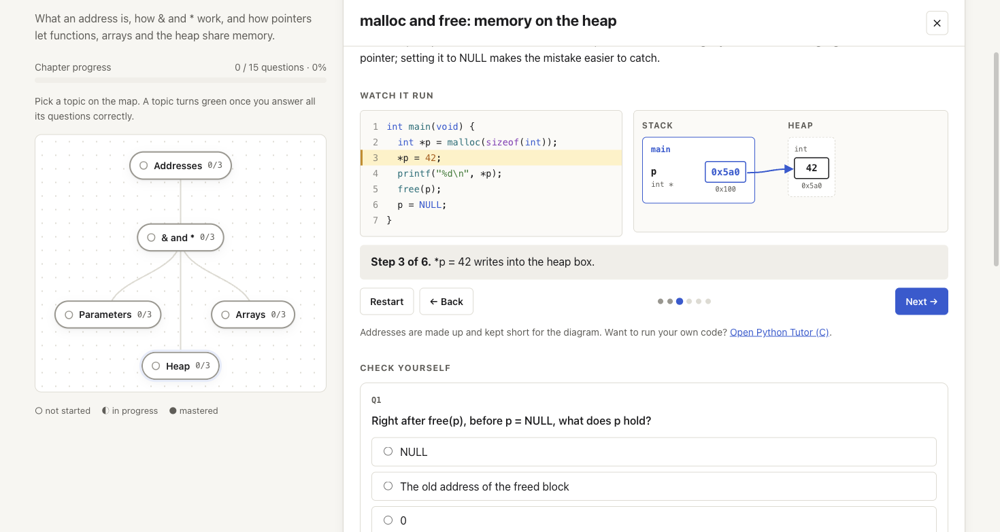
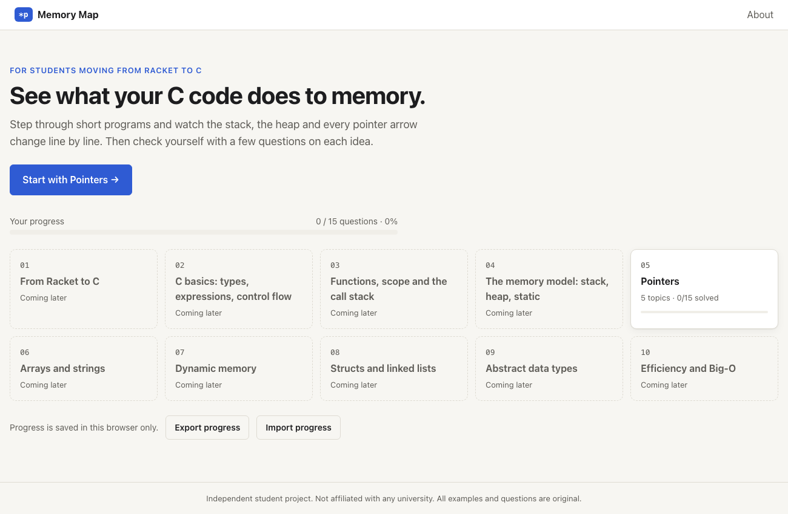

# Memory Map

Step through short C programs and watch the stack, the heap and every pointer
arrow change line by line, then check yourself with a few questions per topic.
Built for students moving from Racket to C, where pointers and memory are the
usual sticking point.

**Status:** early prototype (v0.1, November 2026). One chapter, *Pointers*,
with 5 topics, 5 step-by-step examples and 15 questions. The other nine chapters
in the plan are listed on the home page as "coming later". This version tests the
core idea; the next version will be redesigned closer to the original plan, with
work planned for winter break 2026. See [NEXT_VERSION.md](NEXT_VERSION.md).



*Stepping through `malloc` and `free`: the highlighted line, the stack, the heap and the pointer
arrow all update together. Below the trace are the questions for that topic.*

<details><summary>Home page</summary>



</details>

## Features
- **Step-by-step memory diagrams.** Code on the left with the current line
  highlighted; stack frames and heap blocks on the right. Pointer arrows are SVG
  paths drawn between the measured positions of the pointer and its target, and
  they are redrawn when the layout changes size. Freed heap blocks stay on screen
  with a dashed red arrow to show a dangling pointer.
- **Concept map** for the chapter. Each topic is grey (not started), yellow (some
  questions right) or green (all right), with an icon as well as a colour. On
  phones the map becomes an outline list built from the same data.
- **Questions** (multiple choice and "what does this print?") with feedback.
  Progress counts correct answers, not pages opened, and is saved in
  `localStorage`, with export / import as a JSON file.
- Keyboard support (← / → to step, Esc to close a topic), light and dark mode,
  reduced-motion support.

## How it works
- The site does not run C. Each example is a `Trace`: the code plus a list of
  memory snapshots (`src/types.ts`). This keeps the diagrams exact and avoids
  writing a C interpreter; for running arbitrary code the site links to Python Tutor.
- Hand-written snapshots can contain typos, so `validateTrace`
  (`src/lib/validateTrace.ts`) checks every step: the line number is inside the
  code and not blank, addresses are unique, and every pointer's value matches an
  address that is on screen. A test runs it over all content.
- Hash routing (`#/pointers/heap`) so the site works on GitHub Pages without a server.

## Tests
`npm test` runs 24 Vitest tests:
- content checks over every trace and question,
- unit tests for progress, answer checking, saved-data parsing and the C highlighter,
- UI tests with React Testing Library: stepping with buttons and arrow keys,
  answering all questions in a topic turns it green and saves progress, corrupted
  saved data is ignored, Esc closes the panel.

`npm run test:e2e` runs 15 Playwright end-to-end tests in Chromium against the
production build (`vite preview`):
- **Stepping (desktop, 1280 px):** each of the 5 examples is stepped from first to
  last line. At every step the test checks the highlighted code line, every
  stack and heap value, the number of arrows, and that each arrow starts on its
  pointer and ends at its target box (dangling arrows to freed blocks included).
  Expected values are read from the same content data the site renders.
  Also: arrow-key stepping, Esc to close, the home page → chapter → topic flow.
- **Questions and progress:** wrong answers give feedback and do not count,
  answering a whole topic marks it mastered on the map, progress is written to
  `localStorage` and survives a reload, the chapter can be completed to 100%,
  and corrupted saved data is ignored.
- **Phone (390 px, touch):** the outline list replaces the map, no sideways
  scrolling, a topic opens full screen, arrows still land on their targets, and
  answering a question updates the outline.

Tests find elements by role and label where possible, plus a few `data-testid`s
(`memory`, `arrows`, `question-<id>`).

### Running the tests
```bash
npm install
npx playwright install chromium   # once, downloads the browser
npm run lint
npm run typecheck                 # app, configs and E2E tests
npm test                          # Vitest
npm run test:e2e                  # Playwright (builds and serves the site itself)
npm run test:all                  # all of the above in order
npx playwright test --ui          # Playwright UI mode for debugging
```

### Continuous integration
GitHub Actions (`.github/workflows/ci.yml`) runs lint, typecheck, Vitest and
Playwright on every pull request and on pushes to other branches. If Playwright
fails, the HTML report and failure screenshots are uploaded as the
`playwright-report` artifact. Pushes to `main` run the same job from
`deploy.yml`, and the site is only built and deployed to GitHub Pages after it
passes.

## Run locally
```bash
npm install
npm run dev      # development server
npm run build    # production build in dist/
```

## Stack
React 19, TypeScript, Vite, Vitest, React Testing Library, Playwright, GitHub Actions. No UI or chart
libraries: the concept map, memory diagram, arrows and syntax colouring are
written for this project.

## How it was built
Planned in `PROJECT_OUTLINE.md` (audience, page structure, progress rules,
content rules). Implemented with AI coding agents (Claude Code) working from
the rules in `AGENTS.md`; every change was reviewed, run in the browser at
desktop and phone widths, and checked with the test suite.

## Content
All examples and questions are original and are not taken from any course's
slides, notes, assignments or exams. This is an independent student project and
is not affiliated with any university.
